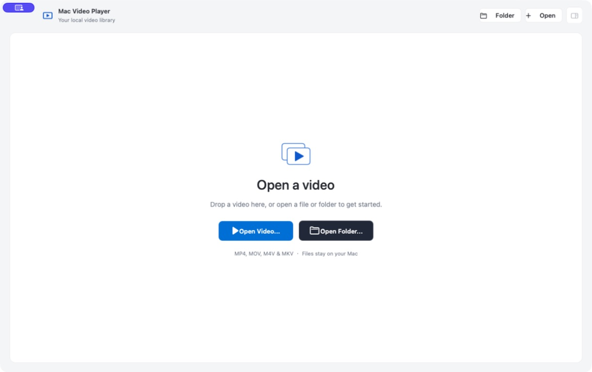
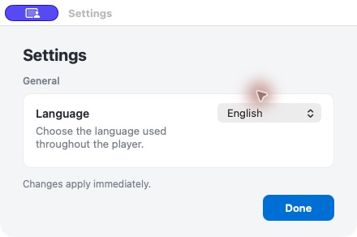

# Mac Video Player

> A clean, native macOS player for local video libraries, with tags, playlists, and familiar keyboard controls.

[English](README.md) · [简体中文](README.zh-CN.md)

<p align="center">
  
</p>

Mac Video Player keeps local viewing simple: open a video or folder, browse the generated playlist, organize files with tags, and play without changing the original media.

## Highlights

- **Native light appearance** — a calm macOS-style interface with a large video canvas and a circular play/pause button.
- **Playback speed** — choose 0.5×, 1×, 1.5×, or 2×; use ⌘⌥− / ⌘⌥= to change speed and ⌘⌥0 to reset. The chosen speed carries across videos.
- **Playback progress** — resume videos from their last position; videos near the end restart from the beginning.
- **Playlist search** — filter filenames alongside tags. Search affects displayed rows; previous and next follow the tag-filtered playlist.
- **Local libraries** — open an MP4, MOV, M4V, or MKV file, or scan a folder to build a playlist automatically.
- **Collapsible playlist** — see each video's format and file size, hide the playlist with the sidebar button to give the video more room, then restore it without losing the current selection.
- **Tags that stay local** — add, remove, and filter tags from the player or the tag editor. Tags are stored separately as JSON and never modify the media file.
- **English and Simplified Chinese** — choose the interface language in **Mac Video Player > Settings…**. The change applies immediately and is remembered.
- **Playback controls** — sequential or shuffle playback, timeline seeking, volume control, Previous and Next, drag-and-drop opening, Finder reveal, and screenshot capture.
- **Non-blocking playback errors** — damaged, unreadable, or undecodable videos show a brief message inside the player. You can keep navigating and using shortcuts; hover over the message for details.
- **Video screenshots** — click **Screenshot** in the title bar or press `⌘⇧S` to save the current frame as a PNG while playing or paused, with a customizable shortcut.
- **Video clips** — choose a start and end using sliders, precise timestamps, or the current playback position, then export a new MP4 with cancellation support.
- **Faster long seeks** — Left and Right Arrow seek by five seconds. Hold either key for more than five seconds to increase each repeated seek by 150% (12.5 seconds per repeat).

## Language settings

<p align="center">
  
</p>

Open **Mac Video Player > Settings…**, select **English** or **简体中文**, and close the window with **Done**. Menus, controls, playlist labels, tag controls, and alerts refresh immediately.

## Controls

| Input | Action |
| --- | --- |
| `Space` | Play or pause |
| `⌘⇧S` | Capture the current video frame |
| `⌘⇧E` | Enter or exit trim mode |
| `I` / `O` in trim mode | Set the current position as the start / end |
| `Esc` in trim mode | Exit trim mode |
| `Up Arrow` / `Down Arrow` | Previous or next video |
| `Left Arrow` / `Right Arrow` | Seek backward or forward 5 seconds |
| Hold `Left Arrow` / `Right Arrow` for over 5 seconds | Seek 12.5 seconds per repeated key event |
| Scroll over the video | Previous or next video |
| Scroll over the volume slider | Adjust volume |

The playlist panel keeps its own normal scrolling. Use the sidebar toggle in the upper-right corner of the player to collapse or reopen it.

Screenshots are saved directly to **Downloads** (`~/Downloads/`) by default, with a confirmation after saving. Choose another folder or restore Downloads in **Mac Video Player > Settings… > Screenshot Location**. The change applies immediately and persists across restarts. You can also choose **File > Capture Screenshot**. Change the shortcut or restore its default in **Mac Video Player > Screenshot Shortcut…**. The shortcut works while the player is active, and the Screenshot button's tooltip shows the current shortcut.

## Video clips

Open a video and click **Trim Video** or press `⌘⇧E` to enter **trim mode in the main player**. Playback pauses and the progress bar becomes a range timeline. Drag the left blue handle to set the start and the right handle to set the end; the blue section is the exported range. Click or drag elsewhere on the track to seek. Dragging previews frames in the video canvas, with an exact seek on release.

The toolbar shows start, end, and clip duration. Enter `HH:MM:SS.mmm`, `MM:SS.mmm`, or seconds for precise adjustments, or seek and choose **Set Start** / **Set End** (`I` / `O`). **Preview** or Space plays from the selected start and pauses at the end. Seeking to the source's last frame stays on that video. Choose **Exit Trim**, press `Esc`, or press `⌘⇧E` again to restore normal controls. Press Return to commit a time edit before using keyboard mode controls.

Choose **Export MP4…** to select a filename and destination (Downloads by default). Exports run in a background queue, and the task panel shows progress, cancellation, and completed files in Finder. Reopen it with **File > Export Tasks**. Switching videos or exiting trim mode leaves tasks running with their captured source and range. Failed or cancelled exports preserve existing destinations and remove temporary files. Unfinished tasks are cancelled before quitting.

The app includes standalone FFmpeg with statically linked FFmpeg/x264 libraries. Clips use H.264 video and AAC audio and support sources such as MKV. Copy the complete application to another compatible Mac to export clips without installing FFmpeg or Homebrew. The current application bundle targets Apple Silicon (arm64) and macOS 13.0 or later.

## Tags

Type a tag in the **Add tag** field and press Return or choose **Add**. The field stays editable while playback state updates, including during input-method composition. Select a tag from the playlist filter to show matching files only.

Tags are stored at:

```text
~/Library/Application Support/MacVideoPlayer/tags.json
```

## Build

### Requirements

- macOS 13.0 or later
- Swift 6 and the macOS Command Line Tools
- The IINA/libmpv runtime in `Vendor/IINAFrameworks`
- Standalone FFmpeg in `Vendor/FFmpeg/bin/ffmpeg`, with its sources, licenses, and build metadata alongside it

If the runtime is absent, install IINA and import its Frameworks directory:

```sh
./scripts/fetch-iina-runtime.sh
```

Set `IINA_APP` if IINA is installed outside `/Applications/IINA.app`:

```sh
IINA_APP="/path/to/IINA.app" ./scripts/fetch-iina-runtime.sh
```

The vendored FFmpeg is ready for packaging. To rebuild it from the supplied source archives, run the following command. It builds entirely inside the project and needs no Homebrew or system installation:

```sh
python3 scripts/build-ffmpeg-runtime.py --jobs 4
```

Build the app bundle (also checking FFmpeg architecture, deployment target, encoders, and external dynamic-library dependencies):

```sh
./scripts/build-app.sh
```

The bundle is written to `build/MacVideoPlayer.app`. Create a DMG with:

```sh
./scripts/build-dmg.sh
```

If a restricted environment cannot generate debug symbols, build with `APP_DEBUG_INFO_FORMAT=none ./scripts/build-app.sh`.

## Verification

Run the Swift tests when XCTest is available:

```sh
swift test
```

The core regression checks work with the Command Line Tools alone:

```sh
python3 scripts/test-regressions.py
```

They cover language persistence, tag entry and input-method behavior, playlist filtering and ordering, keyboard seek acceleration, playback events, command serialization, screenshot paths, and clean DMG staging without opening a player window or decoding media.

Performance regressions also cover background tag writes, concurrent edits and failure recovery, skipped unchanged saves, cached sort orders, scan cancellation, deletion during scanning, and paused progress updates. If an OpenGL pixel format is unavailable, the script reports the hidden-window input checks as skipped and continues with the core checks.

Clip export regressions use a simulated encoder to check timestamp entry, range validation, encoder arguments, cancellation, source and destination protection, retries, and temporary-file cleanup without processing real media.
They also verify bundled-encoder priority, app relocation, an empty PATH, and failure without machine-local fallback when the helper is missing or non-executable.

After building, test real exports from the application bundle. This copies and renames the app, removes Homebrew from PATH, and checks MP4/MKV clips, audio, and selected timestamps with tiny synthetic media. It never opens the player window:

```sh
python3 scripts/test-bundled-ffmpeg.py
```

Checks also cover coalesced playback-event bursts, natural sort equivalence, and tag collection deduplication. Run the scanning and tag benchmarks without launching the player:

```sh
python3 scripts/benchmark-performance.py
```

The benchmark uses temporary files and synthetic tags, reports the median of five measurements, and never decodes media. See the [performance notes](docs/performance.md) for before/after results and measurement scope.

## Runtime and license

The packaged application includes IINA/libmpv, standalone FFmpeg/x264, and related media dependencies. Playback decodes the original file directly and supports hardware decoding where available. Clip export uses the separate bundled tool to write the selected range to a new MP4 file. FFmpeg's corresponding sources, licenses, and build recipes are included in `Contents/Resources/FFmpeg`.

Because distributed builds include the IINA/libmpv runtime, this project is licensed under the GNU General Public License v3.0. Keep the corresponding source and third-party notices available when redistributing.

- [LICENSE](LICENSE)
- [Third-party notices](THIRD_PARTY_NOTICES.md)
- Upstream IINA source reference: `ThirdParty/IINA` at commit `db549a6`

Mac Video Player is not affiliated with or endorsed by IINA, FFmpeg, VLC, Sparkle, or Apple.
